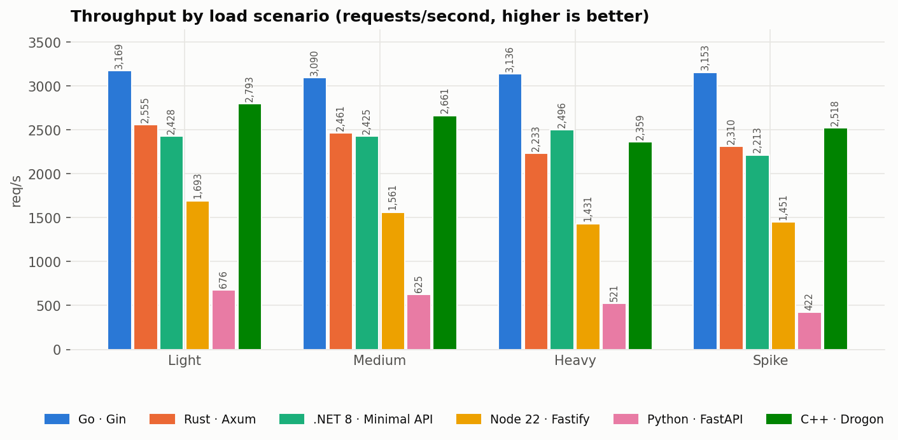
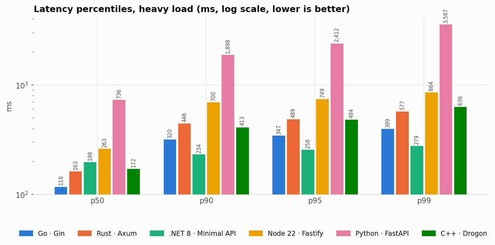
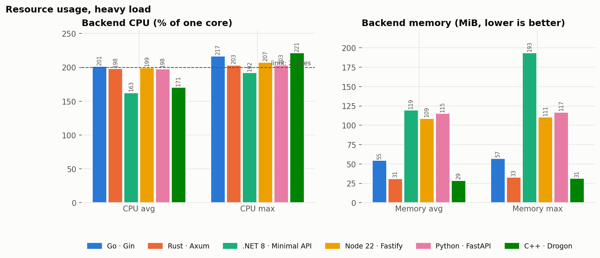
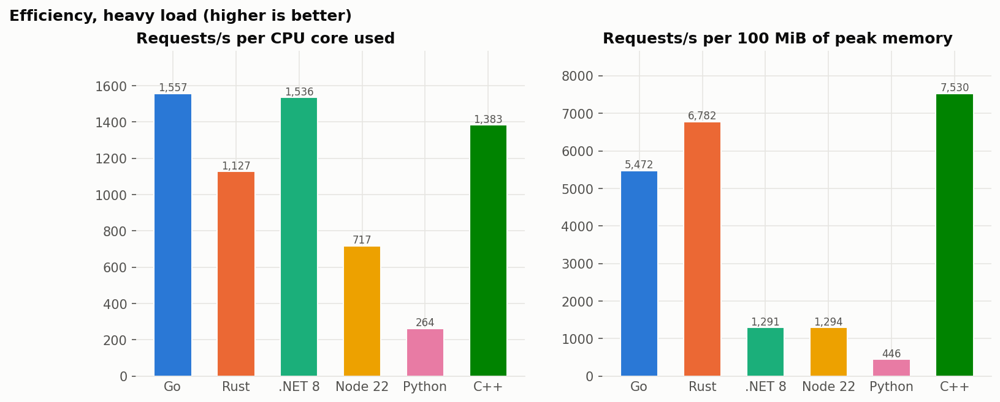
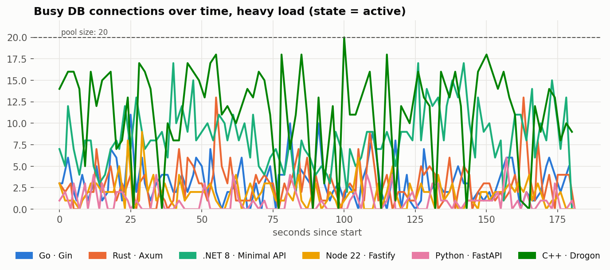
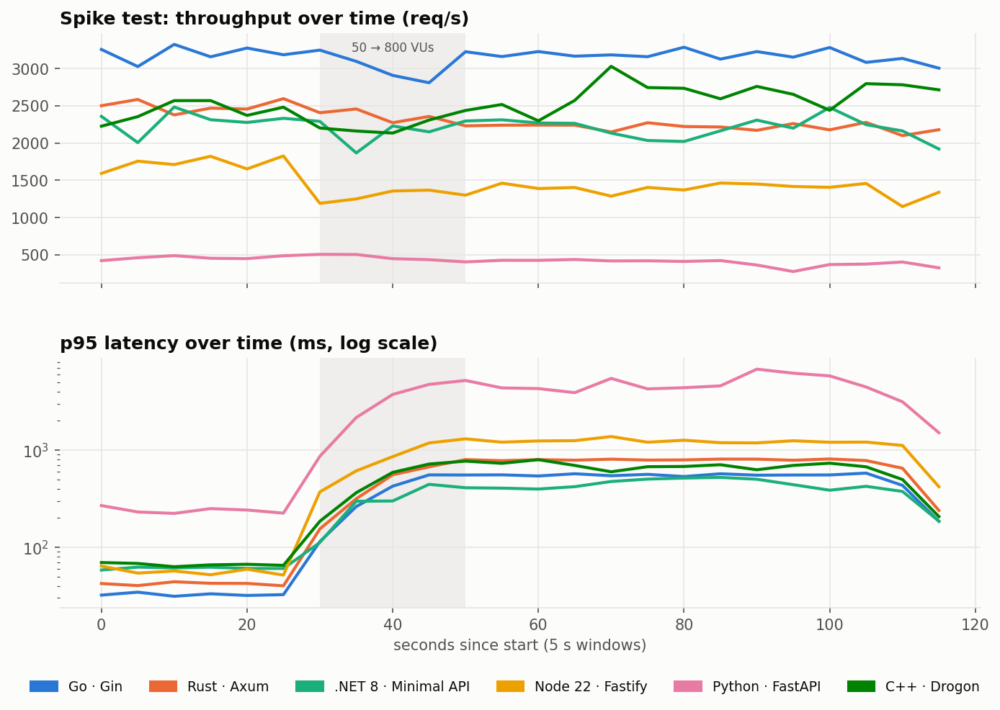
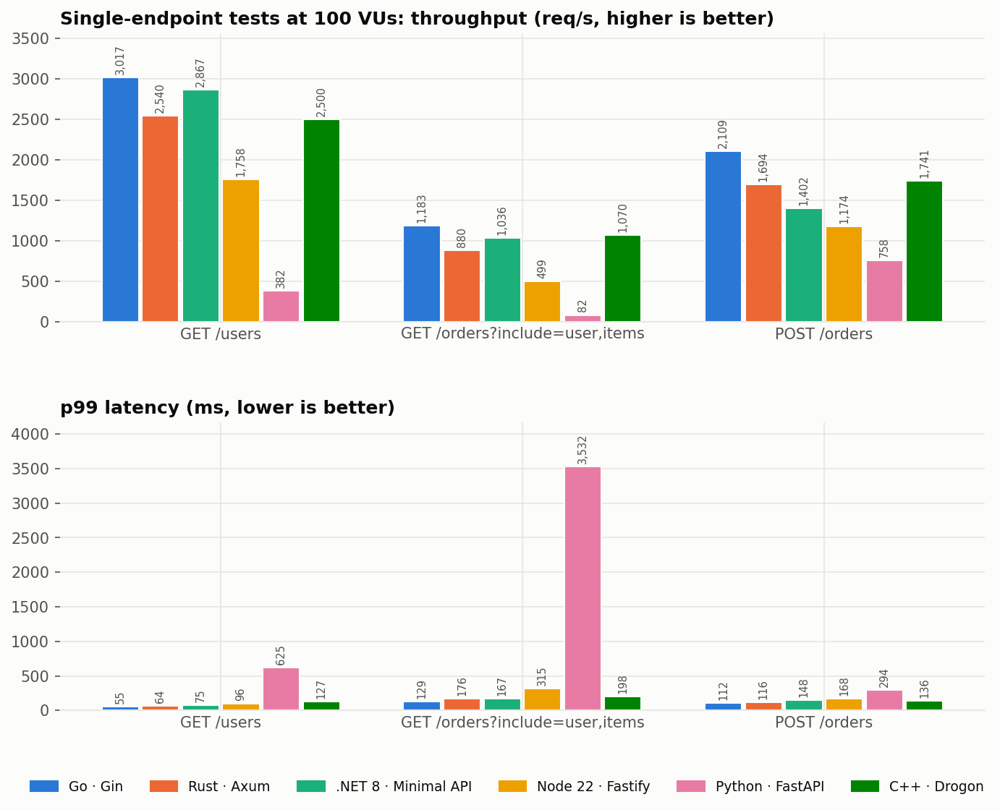
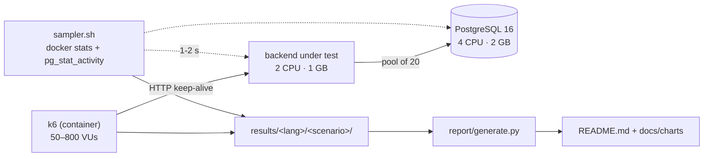
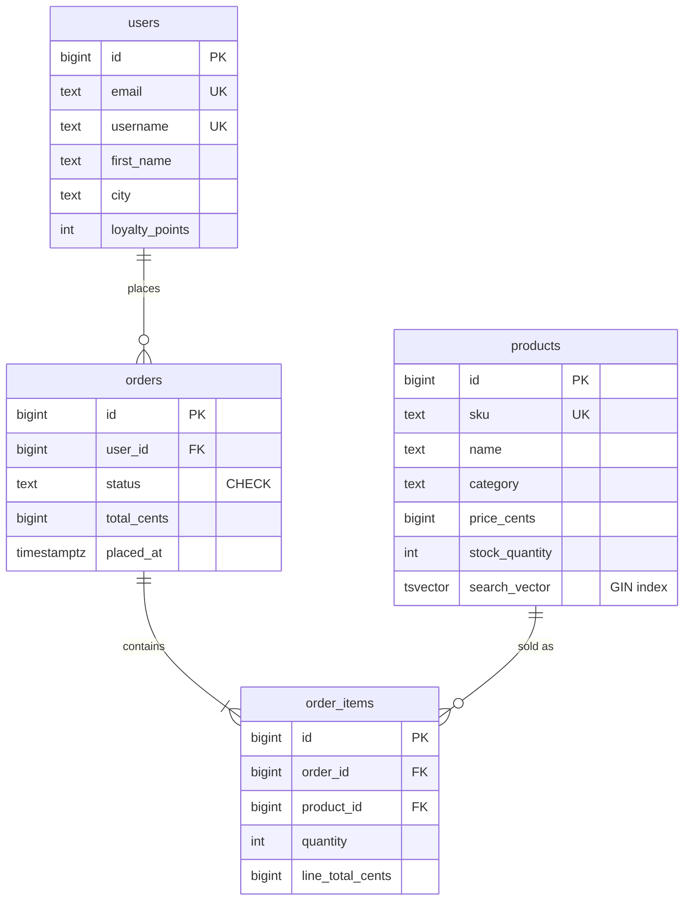

# Backend Perf Battle

The same REST API written in six languages, run against the same PostgreSQL database and load-tested the same way with k6, so the only thing that changes between runs is the language and framework.

| | Language | Framework | DB driver | Runtime setup for 2 CPUs |
|---|---|---|---|---|
| 🐹 | Go 1.25 | Gin | pgx v5 (pgxpool) | `GOMAXPROCS=2` |
| 🦀 | Rust 1.88 | Axum 0.7 | SQLx 0.8 | tokio, 2 worker threads, LTO release build |
| 🟣 | .NET 8 | Minimal API | Dapper + Npgsql 8 | Server GC, TieredPGO (default on) |
| 🟩 | Node 22 | Fastify 5 | node-postgres (`pg`) | `node:cluster`, 2 workers × 10 connections |
| 🐍 | Python 3.12 | FastAPI | asyncpg | uvicorn 2 workers × 10 connections, uvloop, httptools, orjson |
| ⚙️ | C++20 | Drogon 1.9 | Drogon's PostgreSQL client | 2 IO threads × 10 connections, `-O3` |

## Results

<!-- RESULTS:START -->

> Measured 2026-11-19T07:33:25Z on **AMD Ryzen 7 7435HS**, Docker 29.2.1 on Docker Desktop, 16 CPUs, 12377583616 bytes RAM.
> Every backend capped at 2 CPUs / 1 GB, PostgreSQL at 4 CPUs / 2 GB, 20 DB connections per backend.

### Winners

| Category | 🥇 | 🥈 | 🥉 |
|---|---|---|---|
| Throughput (heavy RPS) | 🥇 Go · Gin (3,136 req/s) | 🥈 .NET 8 · Minimal API (2,496 req/s) | 🥉 C++ · Drogon (2,359 req/s) |
| Tail latency (heavy p99) | 🥇 .NET 8 · Minimal API (279.0 ms) | 🥈 Go · Gin (399.4 ms) | 🥉 Rust · Axum (577.5 ms) |
| Memory (heavy peak) | 🥇 C++ · Drogon (31 MiB) | 🥈 Rust · Axum (33 MiB) | 🥉 Go · Gin (57 MiB) |
| CPU efficiency (req/s per core) | 🥇 Go · Gin (1,557) | 🥈 .NET 8 · Minimal API (1,536) | 🥉 C++ · Drogon (1,383) |
| Spike p99 | 🥇 .NET 8 · Minimal API (500.0 ms) | 🥈 Go · Gin (589.9 ms) | 🥉 C++ · Drogon (778.2 ms) |
| Heavy join (GET /orders?include) | 🥇 Go · Gin (1,183 req/s) | 🥈 C++ · Drogon (1,070 req/s) | 🥉 .NET 8 · Minimal API (1,036 req/s) |
| Writes (POST /orders) | 🥇 Go · Gin (2,109 req/s) | 🥈 C++ · Drogon (1,741 req/s) | 🥉 Rust · Axum (1,694 req/s) |

### Throughput



**Requests/second** (bold = best)

| Scenario | Go · Gin | Rust · Axum | .NET 8 · Minimal API | Node 22 · Fastify | Python · FastAPI | C++ · Drogon |
|---|--:|--:|--:|--:|--:|--:|
| Light | **3,169** | 2,555 | 2,428 | 1,693 | 676 | 2,793 |
| Medium | **3,090** | 2,461 | 2,425 | 1,561 | 625 | 2,661 |
| Heavy | **3,136** | 2,233 | 2,496 | 1,431 | 521 | 2,359 |
| Spike | **3,153** | 2,310 | 2,213 | 1,451 | 422 | 2,518 |

### Latency



**p50 (ms)**

| Scenario | Go · Gin | Rust · Axum | .NET 8 · Minimal API | Node 22 · Fastify | Python · FastAPI | C++ · Drogon |
|---|--:|--:|--:|--:|--:|--:|
| Light | 12.9 | 15.0 | 10.9 | 24.6 | 62.8 | **8.0** |
| Medium | **48.9** | 60.2 | 87.4 | 99.6 | 250.0 | 74.4 |
| Heavy | **118.0** | 163.5 | 198.4 | 263.2 | 736.2 | 172.4 |
| Spike | **164.2** | 230.8 | 301.7 | 375.8 | 1,018.4 | 199.1 |

**p95 (ms)**

| Scenario | Go · Gin | Rust · Axum | .NET 8 · Minimal API | Node 22 · Fastify | Python · FastAPI | C++ · Drogon |
|---|--:|--:|--:|--:|--:|--:|
| Light | **33.0** | 40.6 | 62.8 | 57.7 | 158.0 | 64.9 |
| Medium | 139.5 | 176.2 | **108.0** | 269.8 | 781.8 | 178.8 |
| Heavy | 347.1 | 489.2 | **257.7** | 748.9 | 2,412.1 | 483.5 |
| Spike | 521.7 | 750.5 | **418.6** | 1,178.8 | 4,122.0 | 642.0 |

**p99 (ms)**

| Scenario | Go · Gin | Rust · Axum | .NET 8 · Minimal API | Node 22 · Fastify | Python · FastAPI | C++ · Drogon |
|---|--:|--:|--:|--:|--:|--:|
| Light | **40.3** | 50.2 | 73.7 | 74.3 | 211.0 | 75.9 |
| Medium | 161.0 | 204.2 | **146.6** | 303.0 | 1,128.3 | 224.7 |
| Heavy | 399.4 | 577.5 | **279.0** | 863.5 | 3,587.0 | 635.7 |
| Spike | 589.9 | 829.6 | **500.0** | 1,319.0 | 6,551.4 | 778.2 |

**Error rate (%)**

| Scenario | Go · Gin | Rust · Axum | .NET 8 · Minimal API | Node 22 · Fastify | Python · FastAPI | C++ · Drogon |
|---|--:|--:|--:|--:|--:|--:|
| Light | **0.00** | **0.00** | **0.00** | **0.00** | **0.00** | **0.00** |
| Medium | **0.00** | **0.00** | **0.00** | **0.00** | **0.00** | **0.00** |
| Heavy | **0.00** | **0.00** | **0.00** | **0.00** | **0.00** | **0.00** |
| Spike | **0.00** | **0.00** | **0.00** | **0.00** | **0.00** | **0.00** |

### Resources (heavy load, 500 VUs)





| Backend | CPU avg % | CPU max % | Mem avg MiB | Mem max MiB | req/s per core | DB active avg | DB active max | DB conns | Postgres CPU avg % |
|---|--:|--:|--:|--:|--:|--:|--:|--:|--:|
| Go · Gin | 201 | 217 | 55 | 57 | 1,557 | 3.2 | 11 | 21 | 353 |
| Rust · Axum | 198 | 203 | 31 | 33 | 1,127 | 2.9 | 13 | 20 | 324 |
| .NET 8 · Minimal API | 163 | 192 | 119 | 193 | 1,536 | 8.3 | 17 | 21 | 400 |
| Node 22 · Fastify | 199 | 207 | 109 | 111 | 717 | 1.8 | 9 | 20 | 161 |
| Python · FastAPI | 198 | 203 | 115 | 117 | 264 | 0.9 | 6 | 20 | 93 |
| C++ · Drogon | 171 | 221 | 29 | 31 | 1,383 | 11.3 | 20 | 21 | 399 |

CPU % is of one core (200 % = the full 2-CPU limit). *DB active* counts connections running a query at the sampling instant; *DB conns* is the pool size Postgres saw.

### Database connection usage



### p95 per endpoint inside the heavy mix (ms)

| Endpoint | Go · Gin | Rust · Axum | .NET 8 · Minimal API | Node 22 · Fastify | Python · FastAPI | C++ · Drogon |
|---|--:|--:|--:|--:|--:|--:|
| `product_get` | **142.9** | 206.7 | 251.1 | 319.6 | 1,894.2 | 254.0 |
| `user_get` | **142.9** | 207.6 | 251.3 | 318.9 | 1,928.4 | 251.6 |
| `users_list` | **144.5** | 208.2 | 254.0 | 323.1 | 1,906.4 | 258.4 |
| `products_list` | **143.9** | 209.8 | 252.9 | 320.8 | 1,873.4 | 261.5 |
| `orders_include` | 406.1 | 588.6 | **263.4** | 875.9 | 3,515.3 | 664.9 |
| `user_orders` | 272.8 | 399.0 | **255.4** | 590.9 | 2,542.0 | 437.6 |
| `search` | **146.1** | 211.0 | 257.6 | 322.3 | 1,892.1 | 272.2 |
| `order_create` | 160.0 | 223.6 | 278.6 | 363.9 | 1,879.3 | **69.0** |

### Spike test (50 → 800 VUs in 20 s)



### Single-endpoint tests (100 VUs, 60 s)



**Requests/second**

| Endpoint | Go · Gin | Rust · Axum | .NET 8 · Minimal API | Node 22 · Fastify | Python · FastAPI | C++ · Drogon |
|---|--:|--:|--:|--:|--:|--:|
| GET /users | **3,017** | 2,540 | 2,867 | 1,758 | 382 | 2,500 |
| GET /orders?include=user,items | **1,183** | 880 | 1,036 | 499 | 82 | 1,070 |
| POST /orders | **2,109** | 1,694 | 1,402 | 1,174 | 758 | 1,741 |

**p99 (ms)**

| Endpoint | Go · Gin | Rust · Axum | .NET 8 · Minimal API | Node 22 · Fastify | Python · FastAPI | C++ · Drogon |
|---|--:|--:|--:|--:|--:|--:|
| GET /users | **54.6** | 63.7 | 75.4 | 96.5 | 624.6 | 126.9 |
| GET /orders?include=user,items | **129.5** | 175.6 | 167.3 | 315.4 | 3,532.1 | 197.5 |
| POST /orders | **111.9** | 115.7 | 148.1 | 167.8 | 293.8 | 136.1 |

<!-- RESULTS:END -->

## Keeping it fair

- **One machine, one backend at a time.** All the other backends are stopped during a run. k6, PostgreSQL and the backend under test share the host.
- **Same resources.** Each backend container gets `cpus: 2` and `mem_limit: 1g`. PostgreSQL gets 4 CPUs / 2 GB with the same settings every run.
- **Same connection pool.** Every backend opens 20 connections. Runtimes that need two processes to use two cores (Node, Python) split this as 2 × 10.
- **Same SQL.** Every backend runs the statements in [sql/queries.sql](sql/queries.sql) exactly as written. There's no ORM, so the comparison is between languages, not ORMs.
- **Same JSON.** [bench/contract.py](bench/contract.py) runs 45 requests against each backend (reads, writes, every error code) and compares the answers to a reference. A backend that fails this check doesn't get benchmarked.
- **Same starting data.** Before every scenario the database is recreated from a seeded template (`CREATE DATABASE … TEMPLATE`), the backend is restarted, and 15 s of warm-up traffic is discarded.
- **Production builds.** Release/optimized builds, debug and request logging off, no auto-reload.



## Database

The data is an e-commerce dataset generated by [db/seed.sql](db/seed.sql) in pure SQL with a fixed random seed, so every machine gets the same rows. Seeding takes about a minute the first time Postgres starts.

| Table | Rows | Columns |
|---|--:|--:|
| `users` | 30,000 | 20 |
| `products` | 15,000 | 22 (incl. generated `tsvector`) |
| `orders` | 80,000 | 20 |
| `order_items` | 240,372 | 8 |



Schema decisions (full DDL in [db/schema.sql](db/schema.sql)):

- **Money is stored as integer cents** and rating as `rating_x10`. With `NUMERIC`, each language would decode it into a different decimal type (Python's `Decimal` is much slower than the others), so the test would partly measure decimal libraries.
- **Timestamps are formatted by Postgres** through an `iso()` SQL function, so all six backends return byte-identical JSON. The cost is the same for every backend.
- Some users have many orders: `user_id` is skewed so a few users own hundreds of orders while most own one to three.
- Foreign keys: deleting a user or product that an order references gives `409`. Deleting an order cascades to its items.

## API

Every backend serves this API on port 8080.

| Method | Path | Notes |
|---|---|---|
| GET | `/users`, `/products`, `/orders` | `?limit=` (default 20, clamped 1–100), `?offset=`. Response `{"data":[…],"limit":…,"offset":…}`, no `COUNT(*)` |
| GET | `/users/{id}`, `/products/{id}`, `/orders/{id}` | an order includes its `items` |
| POST | `/users`, `/products` | `201`. Missing required field `400`, duplicate email/sku `409` |
| PUT | `/users/{id}`, `/products/{id}`, `/orders/{id}` | partial update, fields not sent are kept. Bad type or status `400` |
| DELETE | `/users/{id}`, `/products/{id}`, `/orders/{id}` | `204`. Still referenced by an order `409` |
| POST | `/orders` | `{user_id, items:[{product_id, quantity}]}`, one transaction. Prices are read from `products`; subtotal, 7 % tax and shipping are computed in the backend |
| GET | `/orders?include=user,items&limit=50` | **heavy**: 3 queries (orders page → users `= ANY($1)` → items `= ANY($1)`), joined into nested JSON in the backend |
| GET | `/users/{id}/orders` | **heavy**: the user's orders with their items |
| GET | `/products/search?q=&category=&min_price=&max_price=&in_stock=true` | **heavy**: full-text search (`tsvector` + GIN), ranked by `ts_rank` |

Errors look like `{"error": "…"}`. A non-numeric id returns `404`.

## Load scenarios

Defined in [bench/k6/bench.js](bench/k6/bench.js). The model is closed with no think time: each virtual user sends its next request as soon as the previous one returns, so the number of VUs is the concurrency.

| Scenario | Load | Duration |
|---|---|---|
| Light | 50 VUs | 60 s |
| Medium | 200 VUs | 180 s |
| Heavy | 500 VUs | 180 s |
| Spike | 50 VUs for 30 s → **800 VUs within 20 s** → hold 60 s → ramp down | 120 s |
| `GET /users` alone | 100 VUs | 60 s |
| `GET /orders?include=user,items` alone | 100 VUs | 60 s |
| `POST /orders` alone | 100 VUs | 60 s |

**Traffic mix** for the four load scenarios. Random ids always exist, and list offsets stay within 0–1000 so `OFFSET` scans don't hide the language differences.

| Share | Request |
|--:|---|
| 25 % | `GET /products/{id}` |
| 15 % | `GET /users/{id}` |
| 10 % | `GET /users?limit=50` |
| 10 % | `GET /products?limit=50` |
| 15 % | `GET /orders?include=user,items&limit=50` |
| 10 % | `GET /users/{id}/orders` |
| 10 % | `GET /products/search` (random term; half also filter by category, some by price or stock) |
| 5 % | `POST /orders` (1–5 items) |

`PUT` and `DELETE` are checked by the contract test but are not in the load mix. Deleting random rows would turn later requests into 404s and inflate the error rate.

**Metrics collected per run:** RPS; latency p50/p90/p95/p99/max; error rate (any non-2xx/3xx or timeout); p95/RPS/errors per 5-second window (for the spike timeline); p95 per endpoint; backend CPU and memory (avg/max, from `docker stats`); Postgres CPU; and DB connections (active/idle/total, from `pg_stat_activity`).

## How to run

Requirements: Docker (Desktop) with **at least 12 CPUs and 8 GB** available to it, and `bash`. On Windows use Git Bash or WSL. Nothing else needs to be installed: k6, the compilers and the report tools all run in containers.

```bash
# Everything: build, contract-check, all 7 scenarios for all 6 backends, then regenerate this README (~2 h)
./bench/run-all.sh

# Only some backends or scenarios
./bench/run-all.sh go rust
SCENARIOS="heavy spike" ./bench/run-all.sh cpp dotnet
COOLDOWN=10 ./bench/run-all.sh python      # shorter pause between scenarios (default 30 s)

# Only regenerate the charts and tables from what's already in results/
docker compose run --rm tools python report/generate.py
```

Close other heavy programs while it runs (browsers, IDE indexing, games), because they compete for the same CPU.

Other things you can do by hand:

```bash
docker compose up -d --wait postgres          # first start seeds the data (~1 min)
docker compose up -d --build rust             # one backend; host ports: go 8081, rust 8082, dotnet 8083,
curl localhost:8082/orders?include=user,items # node 8084, python 8085, cpp 8086
./bench/reset-db.sh                           # restore the seeded data
docker compose run --rm tools python bench/contract.py http://rust:8080 /tmp/rust.json bench/contract-reference.json
docker compose run --rm k6 run -e BASE=http://rust:8080 -e SCENARIO=light /scripts/bench.js
docker compose down -v                        # remove everything, including the seeded volume
```

Run [bench/reset-db.sh](bench/reset-db.sh) only while backends are stopped. It force-drops the database, and the open pools would see errors until they reconnect.

## Caveats

- **Single host.** k6 shares the machine with the backend. On the heaviest runs k6 can take several cores, which is why Heavy stops at 500 VUs and not 1000. Numbers from different machines can't be compared, only rankings.
- **Postgres is shared and can be the ceiling.** When several backends come out with nearly the same RPS on a database-heavy endpoint, they are all waiting on Postgres (see *Postgres CPU* and *DB active* in the resources table), not tied on language speed.
- **Drogon has no SQLSTATE.** Drogon 1.9's PostgreSQL client reports every error without the error code, so the C++ backend maps HTTP status from Postgres' English error text. This affects only error paths, which the benchmark never hits. Drogon is also built with libpq pipeline mode **off**, so it runs one query at a time per connection like the other drivers.
- **Drogon writes JSON by hand.** Its bundled jsoncpp builds a `std::map`-based DOM that cut C++ throughput by more than half, so the C++ backend appends JSON straight into a string from Postgres' text-format results. The other backends use their framework's standard serializer.
- **Docker Desktop on Windows/macOS** runs containers in a VM. Absolute numbers are lower than on bare-metal Linux, but every backend pays the same overhead.
- CPU sampling via `docker stats` runs every ~1.5 s, so a short burst can fall between two samples.

## Repository layout

```
db/            schema.sql · seed.sql · 03-clone.sh (template → bench DB)
sql/           queries.sql — the canonical SQL every backend copies
backends/      go · rust · dotnet · node · python · cpp   (each: source + Dockerfile)
bench/         run-all.sh · reset-db.sh · sampler.sh · contract.py · contract-reference.json · k6/bench.js
report/        generate.py (charts + README tables) · Dockerfile (tools image)
results/       raw output per <lang>/<scenario>: k6 summary.json, stats.csv, db.csv · meta.json
docs/charts/   generated PNGs
```
